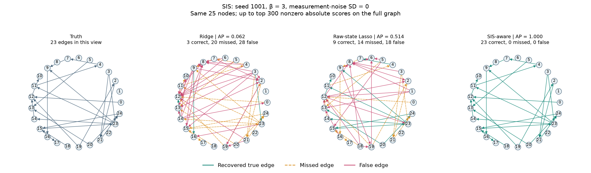
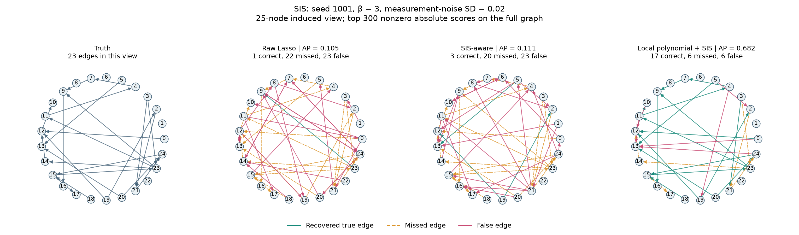

# Recovering networks from dynamics

ESE 5420 final project, Topic 7: recover a sparse directed network from observed
node-state time series, and measure how observation length, noise and knowledge
of the dynamics affect recovery.

Four completed experiments use ten independently generated 100-node,
300-edge networks:

| Experiment | Estimators | Completed fits | Results |
| --- | --- | ---: | --- |
| Noisy linear diffusion | Ridge baseline; Lasso comparison | 180 | [Linear baseline](reference_results/baseline/) |
| Nonlinear SIS dynamics | Raw-state Lasso and ridge | 120 | [SIS comparison](reference_results/sis/) |
| Known SIS dynamics | Nonnegative sparse regression | 60 additional | [Model-based Lasso comparison](reference_results/sis_aware/) |
| Local polynomial preprocessing | Smoothed-state and derivative regression | 60 additional | [Local polynomial comparison](reference_results/sis_local_poly/) |

PNG figures and CSV tables can be viewed directly on GitHub.



## Findings

- **More observations help the ridge baseline.** At measurement-noise ratio
  0.25, ridge's mean edge average precision (AP) increases from 0.306 at 100
  transitions to 0.715 at 300 and 0.942 at 1000. The Lasso comparison reaches
  0.917 at 1000 transitions while predicting better (test RMSE 1.070 vs 1.095).
- **Good predictions do not guarantee network recovery.** For noiseless SIS
  at spreading strength 3, raw-state Lasso's mean AP is 0.438, while its test
  RMSE is only 0.153 times the persistence predictor's RMSE.
- **Knowing the SIS equation helps in the noiseless setting.** The Model-based Lasso
  estimator achieves AP=1 in all 30 noiseless conditions. With measurement noise,
  it does not consistently outperform raw-state Lasso.
- **Local polynomial preprocessing improves recovery with measurement noise.**
  Window selection and derivative estimation substantially improve edge AP across all three spreading strengths.

Mean AP across ten graphs, with measurement-noise SD 0.02:

| SIS spreading strength | Raw-state Lasso | Model-based Lasso | Local polynomial + model-based Lasso |
| --- | ---: | ---: | ---: |
| 0.8 | 0.038 | 0.039 | **0.390** |
| 1.5 | 0.083 | 0.062 | **0.637** |
| 3 | 0.144 | 0.160 | **0.710** |

Local polynomial preprocessing jointly selects the smoothing window and L1 penalty
using five trajectory folds. Paired 95% intervals on its AP gain over Model-based Lasso are:

- β=0.8: +0.350 [+0.315, +0.381].
- β=1.5: +0.574 [+0.557, +0.592].
- β=3: +0.550 [+0.531, +0.573].

These intervals resample ten paired graph/trajectory realizations.
The Model-based Lasso estimator knows the dynamics and rates and imposes nonnegative
weights. SIS states are mean-field infection probabilities.



## Reproduce

The reference environment is Python 3.13.13 with the versions in
[requirements.txt](requirements.txt). Run commands from the repository root.
No external dataset download is required.

```powershell
python -m venv .venv
.\.venv\Scripts\Activate.ps1
python -m pip install -r requirements.txt
python -m unittest discover -s tests -v

# 1. Generate and evaluate the linear experiment.
python scripts/network_recovery.py --jobs 4
python scripts/make_report.py

# 2. Generate SIS observations and fit the raw-state baselines.
python scripts/sis_recovery.py --jobs 4
python scripts/sis_report.py

# 3. Reuse those SIS observations for the model-aware estimator.
python scripts/sis_aware.py --jobs 4
python scripts/sis_aware_report.py

# 4. Select local polynomial preprocessing within training trajectories.
python scripts/sis_local_poly.py --jobs 4
python scripts/sis_local_poly_report.py
```

The checkpoint figure compares the ridge baseline with Lasso at measurement-noise
ratio 0.25: test RMSE and edge average precision with 95% graph-bootstrap
intervals, plus precision-recall curves at 1000 transitions:

```powershell
python scripts/make_checkpoint.py
```

RMSE and AP come from the published baseline metrics; the precision-recall
panel reads per-fit arrays from a local run of `scripts/network_recovery.py`
(`--runs`, default `results/baseline`). To plot fresh metrics too, add
`--metrics results/baseline/metrics.csv`. The figure is saved as
`results/checkpoint/baseline.png`; `--output` selects a different destination.

On macOS/Linux, activate with `source .venv/bin/activate`; the remaining commands
are identical. Use `--jobs 1` to limit parallel CPU use. Nineteen unit tests cover
simulation, edge direction, validation separation, solver equivalence and the
Model-based Lasso regression algebra, local polynomial derivatives and QP refinement. Figure/table scripts also reconcile saved scores and
solver optimality conditions.

Optional pilot runs use seed 5420, excluded from final summaries: add `--pilot`
to the fitting commands. Run the SIS pilot before the Model-based Lasso and local polynomial pilots.

**Output policy:** generated trajectories, fitted coefficients and runtime
protocols go in the ignored `results/` directory. The repository includes
curated, read-only reference snapshots in `reference_results/`. On a fresh clone,
run the experiments above to regenerate the raw files needed by report scripts.
Do not copy reference protocols into `results/` before a fresh run: they record
the original environment and exact file hashes. Existing runtime runs resume
only when their frozen protocol matches; archive that output directory before
changing its experiment configuration or environment.

## Repository contents

```text
scripts/             Experiment runners and figure/table generators
tests/               Unit tests
reference_results/   Reference figures, metrics and provenance
docs/EXPERIMENTS.md   Detailed methods and experimental results
requirements.txt     Pinned numerical dependencies
```

`.gitattributes` keeps LF line endings so recorded code hashes survive a Windows checkout. Local
environments, raw runs, logs and exploratory archives are excluded by
`.gitignore`.

The course manuscript and proposal draft are maintained in a separate Overleaf
repository. They are not part of this code repository.

## Methods and references

Read [the detailed experiment notes](docs/EXPERIMENTS.md) for parameters,
validation, uncertainty and convergence checks. The linear
experiment uses ridge regression as the baseline, tuned by time-ordered
cross-validation, with the course guide's Lasso regression as the comparison.
The Model-based Lasso extension
uses model-based identification with nonnegative sparse regression.

- [Shahrampour and Preciado: topology identification via power spectral analysis](https://arxiv.org/abs/1308.2248).
- [Becker et al.: Wilson–Cowan network identification by inverse transformations](https://www.ieeespmb.org/2016/papers/l04_03.pdf).
- [Prasse and Van Mieghem: network reconstruction for NIMFA processes](https://arxiv.org/abs/1811.06741).
